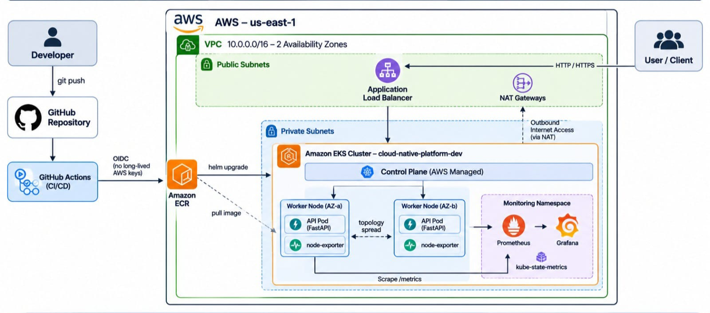
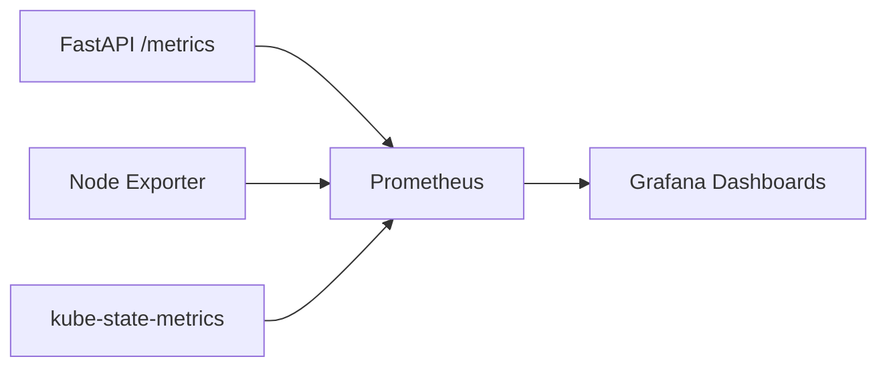

# Cloud-Native Platform on AWS

A cloud-native infrastructure project demonstrating how to design, provision, deploy, monitor, and maintain a containerized application on Amazon Web Services using modern DevOps practices.


## Overview

This project implements an automated cloud-native deployment platform on AWS. It combines Infrastructure as Code, containerization, Kubernetes orchestration, CI/CD automation, and centralized monitoring.

The objective is to build a reliable and maintainable deployment environment where application updates can be delivered automatically, infrastructure resources are managed through code, and application health can be monitored in real time.

### Key objectives

- Provision AWS infrastructure using Terraform.
- Deploy a containerized FastAPI application on Amazon EKS.
- Automate application builds and deployments using GitHub Actions.
- Secure CI/CD authentication through AWS IAM OIDC federation.
- Monitor application and Kubernetes metrics using Prometheus and Grafana.
- Improve application availability through Kubernetes health checks, replicas, and disruption management.
- Evaluate infrastructure resilience through controlled failure scenarios.

## Technology Stack

| Technology | Purpose |
|---|---|
| AWS VPC | Network isolation and infrastructure networking |
| Amazon EKS | Managed Kubernetes orchestration |
| Amazon ECR | Container image registry |
| IAM / OIDC | Secure CI/CD authentication |
| Terraform | Infrastructure as Code |
| Docker | Application containerization |
| Kubernetes | Application orchestration |
| Helm | Kubernetes application packaging and deployment |
| GitHub Actions | CI/CD automation |
| Prometheus | Metrics collection |
| Grafana | Monitoring dashboards |
| FastAPI | Backend application |

## Architecture

The platform is organized into four main layers:

1. **Development and CI/CD:** Source code management and automated delivery.
2. **Cloud infrastructure:** AWS networking, IAM, ECR, and EKS.
3. **Application deployment:** Containerized API running on Kubernetes.
4. **Observability:** Metrics collection and visualization.

### Global architecture

### AWS networking

The infrastructure uses a VPC with CIDR block `10.0.0.0/16`, distributed across two Availability Zones.

| Network component | Responsibility |
|---|---|
| Public subnets | Host the external load-balancing and NAT resources |
| Private subnets | Host EKS worker nodes and application workloads |
| NAT Gateways | Provide outbound Internet connectivity |
| EKS Control Plane | Managed Kubernetes control plane |
| AWS Load Balancer | Exposes the application to external clients |

Worker nodes are placed in private subnets and are not directly exposed to the public Internet.

### Kubernetes architecture

The EKS cluster runs the application across two worker nodes.

The application uses:

- Kubernetes Deployment with two API replicas.
- Rolling updates with `maxUnavailable: 0`.
- Readiness and liveness probes on `/health`.
- Topology spread constraints to distribute application pods.
- PodDisruptionBudget with `minAvailable: 1`.
- Kubernetes Service of type `LoadBalancer`.
- Optional Horizontal Pod Autoscaler (HPA), configured to scale between two and six replicas based on CPU utilization.

## CI/CD Pipeline

The deployment process is automated using GitHub Actions.

### Pipeline workflow

```mermaid
flowchart LR
    A["Developer Push"] --> B["GitHub Repository"]
    B --> C["GitHub Actions"]
    C --> D["AWS OIDC Authentication"]
    D --> E["Build Docker Image"]
    E --> F["Push Image to ECR"]
    F --> G["Helm Lint"]
    G --> H["Helm Upgrade"]
    H --> I["Amazon EKS"]
    I --> J["Deployment Verification"]
```



### Pipeline execution

1. A developer pushes changes to the GitHub repository.
2. GitHub Actions automatically triggers the deployment workflow.
3. GitHub authenticates with AWS through OIDC federation.
4. AWS STS provides temporary credentials.
5. Docker builds the application image.
6. The image is pushed to Amazon ECR using the short Git commit SHA as its tag.
7. Helm validates the Kubernetes chart.
8. Helm deploys or upgrades the application on EKS.
9. The workflow verifies the deployment rollout.

### Security in CI/CD

The pipeline does not require permanent AWS access keys stored in GitHub secrets.

Instead, it uses:

- GitHub OIDC federation.
- AWS IAM role assumption.
- Temporary AWS credentials.
- IAM trust restrictions for the repository and `main` branch.
- Immutable image tags.

## Monitoring and Observability

The platform integrates Prometheus and Grafana to monitor application performance and Kubernetes infrastructure.

### Monitoring architecture



### Metrics collected

| Metric | Description |
|---|---|
| `http_requests_total` | Total number of HTTP requests |
| `http_request_duration_seconds` | HTTP request latency |
| Node metrics | Worker node resource utilization |
| Kubernetes metrics | Pod and deployment states |
| HTTP 5xx rate | Application server error rate |

Prometheus collects metrics from the application and Kubernetes components. Grafana uses PromQL queries to visualize application performance and infrastructure health.

The monitoring dashboard includes:

- Request rate.
- HTTP error rate.
- API latency (p50, p95, p99).
- Requests distribution by pod.
- Available Kubernetes replicas.

## Application API

The backend application is implemented using FastAPI and exposes the following endpoints:

| Endpoint | Description |
|---|---|
| `GET /` | Application information and version |
| `GET /health` | Application health check |
| `GET /api/v1/status` | Application status |
| `GET /metrics` | Prometheus metrics endpoint |

The application uses a lightweight Python image (`python:3.12-slim`) and runs under a non-root user.

## Resilience and High Availability

The project includes controlled resilience scenarios designed to evaluate Kubernetes recovery mechanisms.

| Test scenario | Expected behavior |
|---|---|
| Delete an API pod | Kubernetes recreates the pod |
| Perform a rolling update | Application remains available during deployment |
| Drain a worker node | Pods are rescheduled while respecting the PDB |
| Stop a worker instance | Infrastructure recovery is evaluated |
| Increase application load | HPA scales replicas when enabled |

Continuous HTTP requests and Grafana dashboards are used to observe system behavior during these tests.

Detailed results and screenshots are maintained in `docs/resilience-tests.md`.

**Note:** Actual test outcomes should be documented after each experiment. Expected behavior is not equivalent to a verified test result.

## Security Implementation

Security is addressed at infrastructure, deployment, and container levels.

| Area | Implementation |
|---|---|
| CI/CD authentication | AWS IAM OIDC federation |
| AWS permissions | Dedicated IAM role |
| Container registry | Immutable image tags and ECR scanning |
| Container execution | Non-root user |
| Network isolation | Private worker node subnets |
| Kubernetes availability | Health probes and PodDisruptionBudget |
| Terraform state | Excluded from Git |

## Repository Structure

```text
cloud-native-platform/
│
├── app/
│   ├── Dockerfile
│   ├── requirements.txt
│   └── src/
│       └── main.py
│
├── helm/
│   └── api/
│       ├── Chart.yaml
│       ├── values.yaml
│       └── templates/
│
├── terraform/
│   ├── modules/
│   │   ├── vpc/
│   │   └── eks/
│   └── environments/
│       └── dev/
│
├── monitoring/
│   └── dashboards/
│
├── docs/
│   ├── architecture.png
│   ├── resilience-tests.md
│   └── screenshots/
│
├── .github/
│   └── workflows/
│       └── deploy.yml
│
└── README.md
```

## Deployment Guide

### Prerequisites

- AWS account with appropriate permissions.
- AWS CLI v2.
- Terraform.
- Docker.
- kubectl.
- Helm.
- Git.

### 1. Provision AWS infrastructure

```bash
cd terraform/environments/dev

terraform init
terraform apply
```

Configure Kubernetes access:

```bash
aws eks update-kubeconfig \
  --region us-east-1 \
  --name cloud-native-platform-dev

kubectl get nodes
```

### 2. Deploy the application

Trigger the `build-and-deploy` workflow from GitHub Actions.

The workflow builds the Docker image, pushes it to ECR, and deploys the application using Helm.

### 3. Install monitoring

```bash
helm repo add prometheus-community \
  https://prometheus-community.github.io/helm-charts

helm repo update
```

Deploy the monitoring stack:

```bash
helm upgrade --install monitoring \
  prometheus-community/kube-prometheus-stack \
  -n monitoring \
  --create-namespace \
  --set alertmanager.enabled=false \
  --set grafana.adminPassword='<password>' \
  --set prometheus.prometheusSpec.retention=2d \
  --wait --timeout 10m
```

Access Grafana:

```bash
kubectl port-forward \
  -n monitoring \
  svc/monitoring-grafana 3000:80
```

Open `http://localhost:3000`.

### 4. Test the application

```bash
LB=$(kubectl get svc -n app api \
  -o jsonpath='{.status.loadBalancer.ingress[0].hostname}')

curl http://$LB/
curl http://$LB/health
curl http://$LB/api/v1/status
curl http://$LB/metrics
```

## Cost Management

AWS resources can generate costs while the platform is running.

Important resources to monitor include:

- Amazon EKS control plane.
- EC2 worker instances.
- NAT Gateways.
- AWS Load Balancers.
- Data transfer.

For a development environment, infrastructure should be destroyed when it is no longer required.

### Infrastructure cleanup

Remove Kubernetes resources first:

```bash
helm uninstall api -n app
helm uninstall monitoring -n monitoring
```

Verify that AWS Load Balancers have been deleted, then destroy the Terraform-managed infrastructure:

```bash
cd terraform/environments/dev
terraform destroy
```

## Lessons Learned

During implementation, several practical infrastructure and deployment issues were encountered:

- Kubernetes pod scheduling limitations on small EC2 instances.
- Terraform dependency management for EKS resources.
- Empty ECR repositories after infrastructure recreation.
- GitHub OIDC trust policy configuration.
- GitHub Actions workflow directory requirements.
- Prometheus ServiceMonitor configuration.
- Immutable ECR image tagging.

These challenges helped develop practical experience in AWS infrastructure provisioning, Kubernetes troubleshooting, IAM permissions, and CI/CD debugging.

## Future Improvements

Potential extensions include:

- Terraform remote state using Amazon S3.
- AWS Load Balancer Controller with HTTPS and ACM.
- Karpenter or Cluster Autoscaler.
- Alertmanager and custom alerting rules.
- Trivy image scanning integrated into CI/CD.
- Separate development, staging, and production environments.
- GitOps deployment using Argo CD.
- More restrictive Kubernetes permissions for CI/CD.

## Author

**Mouatassime Andahmou**

Engineering Student — Networks, Systems & Programmable Services (RSSP)

Interested in Cloud Computing, DevOps, Kubernetes, Infrastructure Automation, and Site Reliability Engineering.